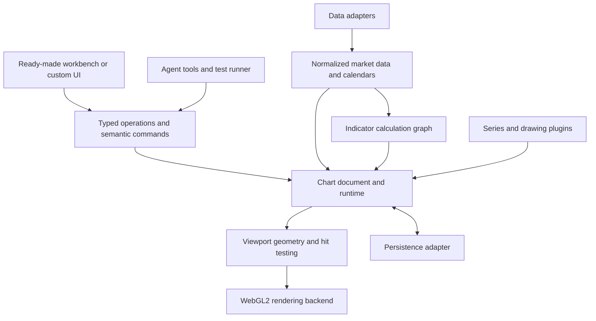

# Proposed chart architecture

Status: target design proposal, October 2, 2026. Package names and APIs below describe the intended design and are not the current implementation contract. The [v0.2 PoC](poc.md) implements a smaller API in `src/`; its current feed and axis decisions are in [the v0.2 design](v0.2-design.md). The source language is TypeScript; distributed code is JavaScript with type declarations. Neither the engine nor the default workbench requires a UI framework.

WebGL2 is the selected launch renderer because order-book and heatmap support are launch requirements. Performance remains to be measured. Canvas2D may support text and overlays; a complete Canvas2D fallback renderer is not a launch requirement. Rust/Wasm remains an optional future computation backend.

## Caller experience

A personal user should get a usable interface, local persistence, and a sample feed without assembling plugins. An integrating company should be able to replace data and UI independently.

```ts
// Proposed high-level entrypoint. Package names are placeholders.
import { createWorkbench } from '@chart/workbench';
import { csvFeed } from '@chart/adapters/csv';

const app = createWorkbench(document.querySelector('#chart')!, {
  data: csvFeed({ url: '/prices.csv', symbol: 'DEMO' }),
  market: { symbol: 'DEMO', interval: { unit: 'day', count: 1 } },
  theme: 'dark',
});

await app.chart.addIndicator('rsi', { length: 14 });
const saved = app.chart.exportDocument();
app.dispose();
```

The workbench includes standard plugins through an explicit preset. A small chart-only entrypoint lets developers choose individual plugins and use their own toolbar.

```ts
import { createChart } from '@chart/chart';
import { candlesticks } from '@chart/series';
import { rsi } from '@chart/indicators';

const chart = createChart(container, {
  data: companyFeed,
  market: { symbol: 'XNAS:AAPL', interval: { unit: 'minute', count: 5 } },
  plugins: [candlesticks(), rsi()],
});

await chart.setMarket({
  symbol: 'XNAS:MSFT',
  interval: { unit: 'minute', count: 5 },
});
chart.dispose();
```

Commands make the same operations available to agents, keyboard shortcuts, and custom UIs. Convenience methods such as `addIndicator` use the same registered operation and validation as `execute`.

```ts
import type { ChartCommand } from '@chart/core';

const current = chart.inspect();
const command = {
  type: 'indicator.add',
  payload: { id: 'rsi-main', kind: 'rsi', inputs: { length: 14 } },
} satisfies ChartCommand;

const preview = chart.preview([command], {
  expectedDocumentRevision: current.documentRevision,
});

if (preview.ok) {
  await chart.execute([command], {
    expectedDocumentRevision: current.documentRevision,
    idempotencyKey: 'add-rsi-main',
  });
}
```

Document revisions cover user edits. Market data has a separate generation and revision, so live ticks do not continually invalidate a harmless settings edit. Commands that depend on a particular data snapshot must declare that dependency. A preview does not reserve state; execution revalidates its preconditions.

## Recommended shape

Use a domain core with adapters at external boundaries and registered plugins for chart behavior. The core owns ordering, identity, state transitions, and cleanup. Plugins contribute capabilities through documented contracts.



The diagram shows responsibilities, not a requirement to publish one npm package per box. Start with a small workspace and clear internal modules. Publish separate packages when they have independently useful contracts or materially affect bundle size.

| Module | Owns | Does not depend on |
| --- | --- | --- |
| `core` | Versioned chart document, commands, validation, transactions, undo, plugin registry | React, DOM, provider transport types |
| `data` | Instrument metadata, canonical storage, pagination, live reconciliation, calendar-aware aggregation, depth snapshot/delta reconstruction | A particular exchange or renderer |
| `indicators` | Calculation dependencies, state, warm-up, rollback, checkpoints, output series | Canvas or toolbar components |
| `geometry` | Time/price transforms, visible range lookup, layout, clipping, hit regions | Network connections |
| `render-webgl` | Batched geometry, heatmap tiles, GPU resources, clipping, pixel density, context recovery | Broker or storage SDKs |
| `presentation` | Text and overlay composition through DOM, Canvas2D or glyph atlases, using shared transforms | Independent copies of chart coordinates |
| `browser` | Pointer/keyboard/touch input, resize, DOM lifecycle, accessibility representation | Application framework state |
| `workbench` | Search, dialogs, toolbars, object tree, settings, responsive layouts | Core internals |
| `adapters` | CSV, REST/WebSocket examples, IndexedDB, host-provided storage, later broker integration | Internal provider assumptions in the core |
| `testing` | Contract fixtures, numerical references, deterministic command replay, benchmark scenarios | Live credentials or a vendor data subscription |

Headless calculation and document manipulation use the core without the browser view. Screenshot generation later needs a browser or explicit server-rendering backend; headless state alone does not promise pixel rendering in Node.

## Adapter and plugin contracts

Adapters translate external systems into our model. Plugins add chart capabilities. Keeping these roles explicit avoids an unrestricted object that exposes every internal service.

| Extension | Contract responsibility |
| --- | --- |
| Data adapter | Resolve instruments, fetch history, subscribe, report capabilities and data provenance, cancel and dispose |
| Calendar adapter | Resolve trading sessions, exceptions and interval boundaries; built-in continuous-market calendar supplied |
| Persistence adapter | Read/write versioned documents with conflict detection; user preferences stored separately |
| Renderer backend | Consume geometry batches, heatmap tiles, fonts, clips and layers; WebGL2 at launch with a provisional backend contract |
| Series/transform plugin | Define input/output requirements, aggregation policy, bounds and portable drawing geometry |
| Scale plugin | Define transform, inverse, domain validation, tick selection and formatting |
| Drawing/tool plugin | Define anchors, gestures, handles, hit testing, editing, settings, serialization and migration |
| Indicator plugin | Declare inputs, dependencies, plots, calculation and correction semantics |
| UI/command plugin | Add controls and semantic actions using public operations, with lifecycle disposal |
| Localization/theme pack | Supply messages, formats, design tokens, fonts and direction metadata |
| Future service adapter | Connect alerts, broker intents or strategy execution without embedding those services into rendering |

Every plugin declares an ID, version, supported API range, requirements, contribution schemas, and cleanup. Resolve dependencies deterministically, reject ID collisions, report unsupported capabilities, and preserve unknown persisted objects for recovery. Plugin unload removes subscriptions, drawings, resources and callbacks it owns. Custom plugin source is trusted application code unless it runs through the later restricted scripting runtime.

Renderer portability needs proof. A plugin that returns portable geometry can support multiple backends. A plugin that directly calls a Canvas or WebGL context declares that dependency. Do not promise that arbitrary custom shaders and drawing callbacks will run on every backend. Stabilize the renderer contract only after a second implementation has exercised it.

Proposed contract sketch. Supporting domain types are abbreviated rather than presented as a complete SDK:

```ts
interface DataAdapter {
  capabilities(): DataCapabilities;
  resolveSymbol(id: string, signal: AbortSignal): Promise<Instrument>;
  history(query: HistoryQuery, signal: AbortSignal): Promise<BarPage>;
  subscribe(query: SeriesQuery, sink: DataSink): Disposable;
}

type DataEvent =
  | { type: 'upsert'; generation: string; revision: number; bar: Bar }
  | { type: 'correct'; generation: string; revision: number; bars: readonly Bar[] }
  | { type: 'reset'; generation: string; reason: string };

interface PersistenceAdapter {
  load(id: string, signal: AbortSignal): Promise<StoredDocument | null>;
  save(document: ChartDocument, expectedVersion?: string): Promise<SaveResult>;
}

interface IndicatorDefinition<State> {
  metadata: IndicatorMetadata;
  initialize(inputs: ValidatedInputs): State;
  step(committed: Readonly<State>, bar: BarContext): StepResult<State>;
}

interface ChartController {
  setMarket(query: MarketQuery): Promise<void>;
  addIndicator(kind: string, inputs: JsonObject): Promise<EntityId>;
  inspect(): ChartInspection;
  preview(commands: readonly ChartCommand[], context: CommandContext): PreviewResult;
  execute(commands: readonly ChartCommand[], context: CommandContext): Promise<CommandResult>;
  exportDocument(): ChartDocument;
  restoreDocument(document: unknown): Promise<RestoreReport>;
  subscribe(listener: ChartListener): Disposable;
  dispose(): void;
}
```

Validate data, persisted documents, commands and plugin manifests at boundaries. Generate TypeScript types and JSON Schema from a shared authoritative definition where practical. TypeScript alone cannot validate data arriving over a socket.

## Market data and identity

Distinguish an intraday UTC instant, an exchange trading date, and a synthetic or event-bar identity. Use explicit units for timestamps, such as `epochMs`, rather than an ambiguous `time` number. Tick and transformed bars can share timestamps, so timestamp alone cannot be their unique key.

An instrument describes venue, asset identity, exchange timezone, calendar, tick size, units, and adjustment policy. A series key includes the instrument, interval, session mode, transformation and adjustment settings. Define month, week and day aggregation in calendar terms. They are not interchangeable with a fixed number of milliseconds. TradingView's [time and session documentation](https://www.tradingview.com/charting-library-docs/latest/connecting_data/time-and-sessions/) is a useful reference for these distinctions.

Store market instants separately from display timezones and logical viewport positions. Drawings persist semantic anchors such as bar identity and price, time and price, or screen position. Raw array indexes cannot survive history insertion or a timeframe change reliably. Define a policy for anchors that no longer resolve.

The runtime owns history/live reconciliation. Buffer or sequence the handoff from history to live updates, reject stale generations, deduplicate overlaps, and reconcile reconnect gaps. A symbol switch cancels outstanding work. Late results cannot populate the next symbol. The adapter documents its sequencing guarantees; feeds without sequence numbers use a declared reconciliation policy.

Keep canonical bars separate from display aggregates. Rendering may combine dense candles by first open, maximum high, minimum low, last close and summed volume. Indicators use canonical data at their requested resolution. Rendering optimization must not change indicator inputs.

Include depth snapshots/deltas and quotes as launch datasets. Leave capability-specific extension contracts for trades, numeric series and events without forcing them into OHLCV fields. Share identity, cancellation and revision rules across dataset kinds. The order book is canonical state reconstructed from snapshots and ordered deltas; the heatmap is a time/price projection of that state. Detect gaps and invalidate the affected interval until a valid snapshot restores the book. Never draw missing history as zero liquidity.

The launch heatmap supports a bounded recorded window and one documented provider adapter, plus deterministic offline fixtures. Distinguish data captured since connection from historical depth supplied by a provider. Specify price-bin aggregation, time sampling, quantity units and intensity normalization. Keep raw book values available for inspection; changing the color scale must not change the data.

## Performance decisions

Use WebGL2 for candles, lines, chart geometry and depth heatmaps at launch. Batch repeated geometry, retain GPU buffers, upload changed ranges, and use bounded time/price heatmap tiles with incremental texture updates. Use visible-range indexing, cached extrema and one frame scheduler. Repainting a crosshair should not recalculate studies or rebuild historical geometry. Benchmark the prototype against Canvas-based libraries on their supported workloads without maintaining a second full renderer solely for comparison.

Use chunked column storage internally where benchmarks support it, with friendly object arrays at the public boundary. Avoid rebuilding all arrays on each tick. Use Float64 or an explicit numeric policy for canonical prices; convert to local screen coordinates before lower-precision GPU buffers. Exact decimal and tick-size metadata must survive display formatting.

Measure computation workers before making them mandatory. Initially the data runtime owns canonical bars; workers receive versioned chunks/deltas and own their calculation caches. Results carry generation/revision tags. Count transferred and duplicated memory, and reject stale results. SharedArrayBuffer must not be required for ordinary embeds.

Use DOM for accessible controls and the readable order-book ladder, with row virtualization where needed. Choose Canvas2D overlays or glyph atlases for chart text after measuring text density and composition cost. All layers use one coordinate/layout model and a coordinated frame revision. Keep hit testing on indexed CPU geometry initially so pointer movement does not require synchronous GPU readback.

Budget GPU memory and contexts per workspace. On context loss, retain canonical data and chart documents, show an explicit recovery state, and rebuild buffers/textures on restoration. If WebGL2 is unavailable or cannot initialize, return a structured capability error and show a useful unsupported-device state. Optional limited rendering can be added later. Test this behavior with context loss and device limits, as recommended by [MDN's WebGL guidance](https://developer.mozilla.org/en-US/docs/Web/API/WebGL_API/WebGL_best_practices).

Consider WebGPU and Rust/Wasm only when measurements justify them. Rust/Wasm would accelerate selected computation or scripting tasks behind a batch-oriented contract, while the public SDK remains TypeScript/JavaScript. Neither is a launch dependency.

Separate event ingestion from display frequency. Coalesce visual updates, but preserve the events required by indicator, replay or alert semantics. Backpressure must be explicit; never silently drop trades needed to compute a footprint.

## Indicators and later scripting

Prove one stateful indicator early, then add a catalog. For each definition, specify warm-up, seed method, missing values, numeric tolerance, session resets and whether the output can repaint.

For a live candle, recalculate from the committed state immediately before that candle. Commit once at bar closure. A historical correction invalidates affected outputs and downstream dependencies. Checkpoints make replay bounded where possible, although a recursive calculation may still require the entire remaining suffix. Higher-timeframe inputs expose confirmed and provisional modes explicitly. [Execution model reference](https://www.tradingview.com/pine-script-docs/language/execution-model/).

Provide three authoring levels over one calculation runtime:

1. Trusted TypeScript/JavaScript definitions for maintainers and integrators.
2. A small formula builder with typed inputs, common studies and plots.
3. An editor for a documented, restricted indicator language, with diagnostics, completion, profiling and deterministic execution.

Prefer familiar expressions such as `sma(close, 20)` without committing to syntax before user testing. Do not promise Pine compatibility. Pine import could become a separately specified subset with explicit unsupported constructs.

Untrusted scripts need a restricted interpreter or isolated runtime with bounded instructions, memory, output objects and execution time. Data dependencies pass through host capabilities. A Worker provides scheduling isolation, but still has network-capable APIs; it is not a complete sandbox. [MDN Web Workers](https://developer.mozilla.org/en-US/docs/Web/API/Web_Workers_API/Using_web_workers).

## Developer and agent experience

Provide a small quickstart, ESM exports, declarations, a pinned browser build, examples that run without credentials, readable stack traces, stable error codes, and cancellation/disposal examples. Imports must be safe in server-rendered apps until a browser view is mounted. Framework wrappers only own mounting, updates and teardown.

A repository map, versioned API reference, `llms.txt`, package ownership notes, runnable recipes, and generated schema catalog help agents modify code. A meaningful contribution can run the relevant adapter or plugin conformance suite without discovering an entire test system.

Runtime inspection should return series and plugin identities, pane/scale relationships, pending loads, data revisions, bounds, diagnostics and selected values. Paginate data inspection. Agents should not receive a million-bar JSON dump to answer a question about one visible pane.

Use atomic document edits, stable object IDs, revision checks, bounded idempotency records, structured errors and observable completion. Record a reproducible bug bundle containing commands, versions, configuration, and an explicitly included fixture. Keep API keys and private feed payloads out by default. Screenshot checks complement semantic assertions because valid state does not guarantee a readable chart.

A later CLI or MCP bridge calls these same contracts. It is optional and host-controlled. Broker execution has a separate capability boundary; adding an indicator must never grant authority to submit an order.

## Alternatives and synthesis

Two structurally different designs were considered: an independent engine and a workbench built around an existing open-source engine.

| Candidate | What it hides for consumers | Main cost | Decision |
| --- | --- | --- | --- |
| Independent WebGL2 engine and workbench | Data reconciliation, chart state, calculations, geometry and rendering behind one consistent model | More engineering before the first useful release | Selected direction for launch; phase 0 validates implementation and budgets |
| Workbench over KLineChart or Lightweight Charts | Existing rendering and interactions behind an engine adapter | Upstream semantics constrain persistence, drawing behavior and portability | Comparison baseline and source of reuse opportunities; it must satisfy launch depth workloads to replace the selected route |

The proposal uses the first candidate's domain ownership and portable plugin model. It adopts the second candidate's narrow adapter boundaries, conformance tests and early reuse evaluation. It rejects exposing upstream drawing objects as our durable document format or claiming renderer replacement is a free configuration change.

We accept a later first release in exchange for independent semantics and extension control. We accept a provisional renderer contract until a second backend exposes real requirements. We accept a focused first feature catalog in exchange for verified editing, persistence and calculation behavior.

The design review rejected unrestricted mutable plugin contexts, one-method forwarding packages, provider-specific public types, and public lifecycle sequences that callers must coordinate. `createWorkbench` and the controller should hide that coordination.

Decisions to resolve with the first implementation experiment: Which WebGL2 batching and heatmap tiling scheme meets the selected workloads? Which text strategy keeps overlays aligned at acceptable cost? Which worker boundary reduces total latency and memory? What existing components can be reused through public APIs? Answer these with prototypes and integration tasks before stabilizing the SDK.

The v0.2 implementation now covers the initial chart slice and a public live feed. The next evidence needed is a recorded depth fixture and measurements against pinned existing engines on supported workloads. The demo heatmap remains removed until its data semantics and presentation have been validated.
